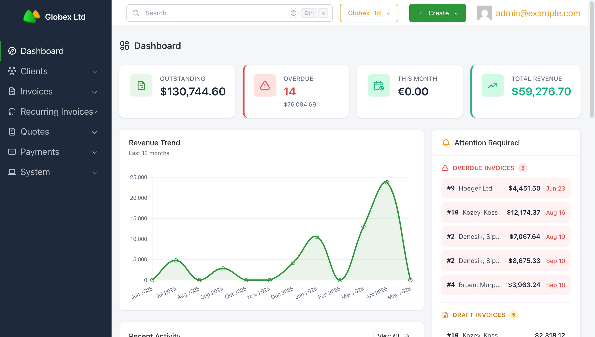
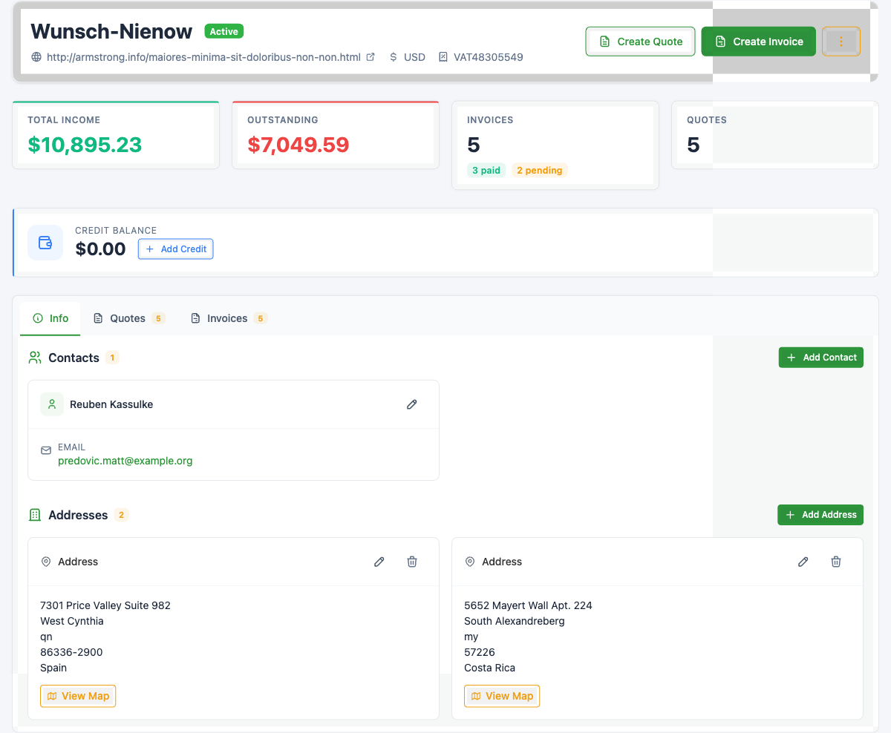
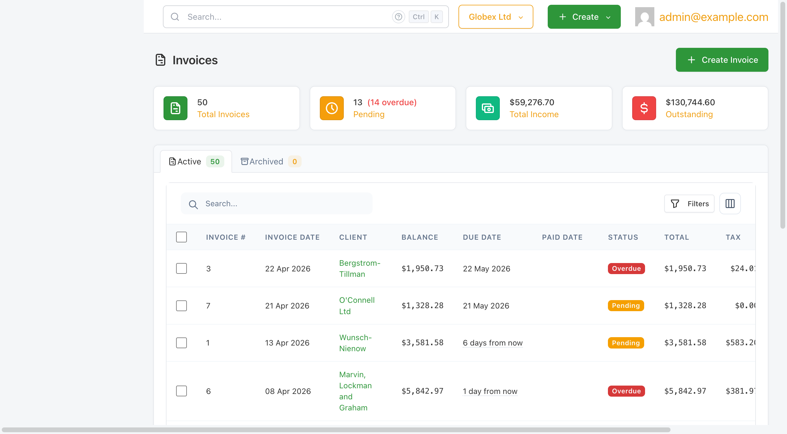
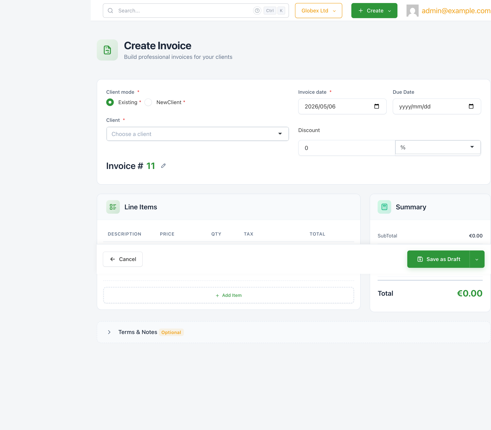
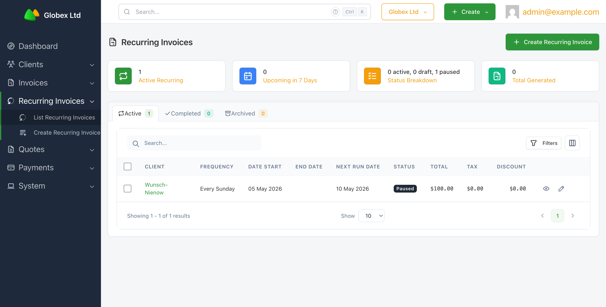
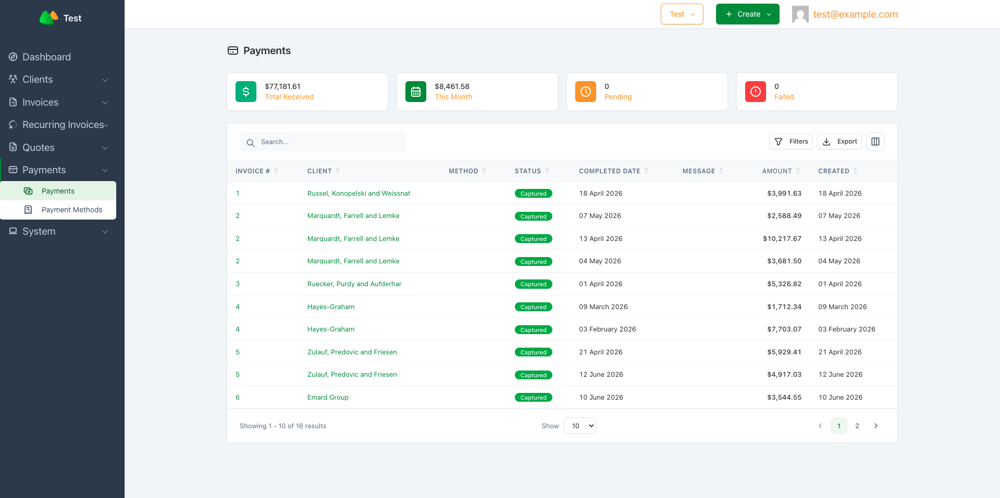

<div align="center">


# SolidInvoice

**[SolidInvoice](https://solidinvoice.co/open-source) is open source invoicing software for freelancers and small businesses.** Self-host it for free or use the hosted cloud.

Send quotes and invoices, take online payments, automate recurring billing and payment reminders, and keep full ownership of your data.

<p>
  <a href="LICENSE"></a>
  <a href="https://github.com/SolidInvoice/SolidInvoice/releases/latest"></a>
  <a href="https://github.com/SolidInvoice/SolidInvoice/actions/workflows/unit-tests.yml"></a>
  <a href="https://hub.docker.com/r/solidinvoice/solidinvoice"></a>
  <a href="https://www.php.net/"></a>
  <a href="https://github.com/SolidInvoice/SolidInvoice/stargazers"></a>
  <a href="https://artifacthub.io/packages/search?repo=solidinvoice"></a>
</p>

<p>
  <a href="https://solidinvoice.co/pricing"></a>
  <a href="https://solidinvoice.co/download"></a>
</p>



</div>

---

## Two ways to run it

- **Use the cloud (free plan):** sign up at [solidinvoice.co/pricing](https://solidinvoice.co/pricing). Nothing to install, with updates and backups handled for you.
- **Self-host:** get the binary, Docker image or package from [solidinvoice.co/download](https://solidinvoice.co/download), or jump to the [Quick Start](#-quick-start) below.

Both run the same codebase.

## Why SolidInvoice?

SolidInvoice has been in development since 2013 and is MIT licensed, so you can run it on your own server, read every line, and fork it if you need to. If you are comparing options, see our roundup of the [best open source invoicing software](https://solidinvoice.co/best-open-source-invoicing-software).

---

## ✨ Features

- **Invoices and quotes:** turn an accepted quote into an invoice in one click, with per-line discounts and custom fields
- **Recurring invoices:** generated and emailed to your client automatically on the schedule you set
- **Online payments:** Stripe, PayPal, Authorize.Net, Klarna and other gateways via [Payum](https://payum.gitbook.io/payum/), with a payment link in every invoice email
- **Automatic payment reminders:** an optional reminder before the due date, then reminders at 1, 7 and 14 days overdue
- **Client management:** clients, contacts, per-client currency, client credit and custom fields
- **Multi-currency:** money is stored as `Money` objects, so there are no float rounding errors
- **Tax rates:** multiple taxes per line, flat-rate or percentage, with rates snapshotted when a document is issued
- **REST API and GraphQL:** built on [API Platform 4](https://api-platform.com/), with token authentication
- **MCP server for AI assistants:** connect Claude, Cursor, Codex or other remote MCP clients over OAuth 2.1 ([docs](https://solidinvoice.co/docs/ai/mcp-server))
- **Multiple companies and users:** run several companies from one install and invite teammates
- **Security:** two-factor authentication (TOTP), optional Google login, email verification
- **Data export:** export any grid to CSV, JSON or XML, or download a full company archive
- **Notifications:** email, SMS and chat channels via Symfony Notifier

Design templates for invoices and quotes are available on the cloud plans. There are no native mobile apps (the web app is responsive) and no importer from other invoicing tools yet.

---

## ☁️ Cloud vs. 🏠 Self-hosted

Self-hosted has no limits. Cloud features depend on your plan.

|                              | 🏠 **Self-hosted** (free, MIT) | ☁️ **Cloud** |
| ---------------------------- | ------------------------------ | ------------ |
| Price                        | Free forever                   | Free plan (online payments included), Solo $9, Pro $19, Business $39 per month ([pricing](https://solidinvoice.co/pricing)) |
| Trial                        | n/a                            | Optional 30-day Pro trial, no card needed, started from inside the app whenever you want |
| Setup                        | You install and maintain       | Sign up and start invoicing |
| Updates                      | Manual                         | Automatic |
| Backups                      | You manage                     | Daily, managed for you |
| Branding                     | Yours                          | SolidInvoice branding removed on Pro and Business |
| Data ownership               | Full                           | Full, export anytime |

---

## 📸 Screenshots

| | |
| :---: | :---: |
| <br/>**Dashboard** | <br/>**Client view** |
| <br/>**Invoice list** | <br/>**Invoice editor** |
| <br/>**Recurring invoices** | <br/>**Payments** |

---

## 🚀 Quick Start

All install methods (binary, Homebrew, Docker, Linux packages, Proxmox, Helm, shared hosting) are listed at **[solidinvoice.co/download](https://solidinvoice.co/download)** and in the [installation guide](https://solidinvoice.co/docs/installation-guide).

### Option 1: Cloud

Sign up at **[solidinvoice.co/pricing](https://solidinvoice.co/pricing)** and start on the Free plan. No server needed.

### Option 2: Docker

```bash
docker run -d -p 8765:8765 -v solidinvoice_data:/etc/solidinvoice solidinvoice/solidinvoice
```

Open port 8765 in your browser and follow the setup wizard. The `solidinvoice_data` volume keeps your config and data when you upgrade the container. See the [Docker guide](https://solidinvoice.co/docs/installation-guide/docker) for Compose and configuration options.

### Option 3: Single binary or Homebrew

A self-contained binary with its own PHP runtime. No web server or PHP extensions to install, and SQLite works out of the box.

**macOS / Linux (Homebrew):**

```bash
brew install solidworx/tap/solidinvoice
solidinvoice run
```

**Linux one-liner:**

```bash
curl -fsSL https://raw.githubusercontent.com/SolidInvoice/SolidInvoice/3.0.x/packaging/install.sh | sh
solidinvoice run
```

Other platforms: download the binary from [solidinvoice.co/download](https://solidinvoice.co/download). SolidInvoice starts on `https://localhost:8765` (self-signed certificate). See the [quick install guide](https://solidinvoice.co/docs/installation-guide/quick-install) for details.

### Option 4: From source (for developers)

```bash
git clone https://github.com/SolidInvoice/SolidInvoice.git
cd SolidInvoice
composer install
bun install && bun run dev
```

For production builds:

```bash
bun run build
```

**Requirements:** PHP 8.4+, ext-curl, ext-gd, ext-intl, ext-json, ext-openssl, ext-pdo, ext-soap, ext-xsl, and SQLite, MySQL/MariaDB or PostgreSQL.

⭐ If SolidInvoice is useful to you, please [star the repo](https://github.com/SolidInvoice/SolidInvoice/stargazers). It helps other people find the project.

---

## 🛠 Tech Stack

**Backend:** Symfony 8.1 · PHP 8.4 · Doctrine ORM · API Platform 4 · Payum · MoneyPHP · Symfony Messenger
**Frontend:** Tabler · Bootstrap 5.3 · Stimulus · Webpack Encore · Bun · Sass
**Ops:** Docker · Helm chart for Kubernetes · optional Meilisearch search · optional Prometheus metrics
**Quality:** PHPStan · ECS · Rector · PHPUnit · Foundry · GitHub Actions

---

## 📚 Documentation

- 🌐 Website: [solidinvoice.co](https://solidinvoice.co)
- 📖 Docs and guides: [solidinvoice.co/docs](https://solidinvoice.co/docs)
- 🔄 Upgrading: [`UPGRADE.md`](UPGRADE.md)
- 📝 Changelog: [`CHANGELOG.md`](CHANGELOG.md)

---

## 💬 Feedback

Using SolidInvoice, in the cloud or self-hosted? Tell us what works, what gets in your way, and what's missing in our [5-minute feedback form](https://docs.google.com/forms/d/e/1FAIpQLSeJ5pJjGzLXaN_a2TjT4_rMYnl71hi7xYuLCopkhphg-VTfgg/viewform). It's anonymous and every question is optional.

---

## 🎁 Refer & Earn

Earn up to $93 a year for every customer you refer to [SolidInvoice Cloud](https://solidinvoice.co). Join the affiliate program, share your link, and earn 20% of every payment your referrals make, month after month. Self-hosted users can take part too.

<a href="https://billing.solidinvoice.co/affiliates"></a>

---

## 🤝 Contributing

We welcome contributions of every shape: code, docs, translations, bug reports and ideas. Look for the [`good first issue`](https://github.com/SolidInvoice/SolidInvoice/labels/good%20first%20issue) label to get started, then read the [contributing guide](CONTRIBUTING.md) and our [code of conduct](CODE_OF_CONDUCT.md).

---

## 🔒 Security

Found a vulnerability? Please **do not** open a public issue. See [`SECURITY.md`](SECURITY.md) for our responsible disclosure process.

---

## 💖 Sponsors & Acknowledgements

SolidInvoice is built and maintained thanks to our sponsors. Want to support the project? **[Become a sponsor](https://github.com/sponsors/SolidInvoice?o=esc)**.

A huge thank-you to:

- **[JetBrains](https://www.jetbrains.com/)**: PhpStorm licenses
- **[Docker](https://www.docker.com/)**: Docker Hub subscription
- **[Sentry](https://sentry.io/)**: Sponsored Business plan

---

## 📄 License

SolidInvoice is open source software released under the [MIT License](LICENSE).

---

<div align="center">

**[Website](https://solidinvoice.co)** · **[Cloud](https://solidinvoice.co/pricing)** · **[Download](https://solidinvoice.co/download)** · **[Docs](https://solidinvoice.co/docs)** · **[Releases](https://github.com/SolidInvoice/SolidInvoice/releases)** · **[Sponsor](https://github.com/sponsors/SolidInvoice?o=esc)**

Made with ❤️ by [SolidWorx](https://solidworx.co) and [contributors](https://github.com/SolidInvoice/SolidInvoice/graphs/contributors).

</div>

<!-- GitAds-Verify: 5A777YN6A52PDTET1VL1VHZGIO89ZZT5 -->
